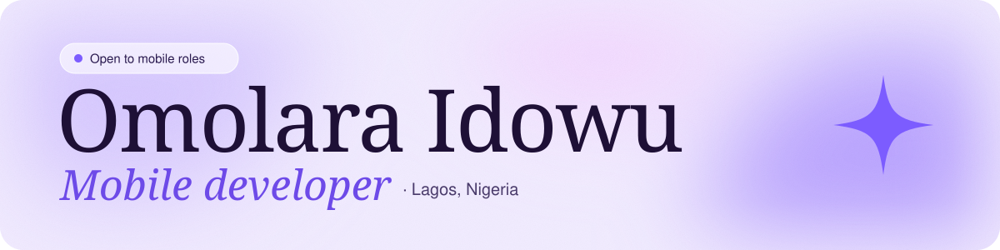

  

  
  
  

##  About me

I'm **Lara**, a mobile developer in Lagos. I turn Figma files into pixel-accurate, animated screens and put clean
architecture underneath them: mostly Android in Kotlin and Jetpack Compose, plus Flutter and Kotlin Multiplatform for
iOS.

 **Building:** Ledjer, an offline-first cashbook for small traders on Android and iOS

 **Exploring:** Compose Multiplatform on iOS, motion and animation in Compose, offline-first sync

 **Goals:** ship Ledjer on the Play Store and App Store, join a mobile team building something people use
every day, and keep getting deeper at architecture and testing

 **Ask me about:** Jetpack Compose, turning Figma into pixel-accurate UI, Paging 3, Kotlin Multiplatform, Flutter

  

##  Tech stack

  

<table>
<tr>
<td><b>Platforms</b></td>
<td>

</td>
</tr>
<tr>
<td><b>Languages</b></td>
<td>

</td>
</tr>
<tr>
<td><b>Android</b></td>
<td>

</td>
</tr>
<tr>
<td><b>Architecture</b></td>
<td>

</td>
</tr>
<tr>
<td><b>Data</b></td>
<td>

</td>
</tr>
<tr>
<td><b>Cross-platform</b></td>
<td>

</td>
</tr>
<tr>
<td><b>Testing</b></td>
<td>

</td>
</tr>
<tr>
<td><b>Tools</b></td>
<td>

</td>
</tr>
</table>

##  GitHub analytics

  <picture>
    <source media="(prefers-color-scheme: dark)" srcset="https://streak-stats.demolab.com?user=OmolaraIdowu&theme=dark&hide_border=true&disable_animations=true&background=FFFFFF00&ring=A78BFA&fire=A78BFA&currStreakLabel=C4B5FD" />
    
  </picture>

<picture>
  <source media="(prefers-color-scheme: dark)" srcset="https://raw.githubusercontent.com/OmolaraIdowu/OmolaraIdowu/output/github-snake-dark.svg" />
  
</picture>

##  Fun facts

- 🧾 I studied accounting before mobile development, so apps that handle money feel like home: bill payments, bookings, a cashbook.
- 🗣️ Fluent in English, Yoruba and Kotlin.
- 🎨 If an icon isn't in the design file, I'll draw it myself.

##  Reach me

The fastest way is through my [portfolio](https://gailbyte.web.app) or [LinkedIn](https://linkedin.com/in/omolara-idowu).

